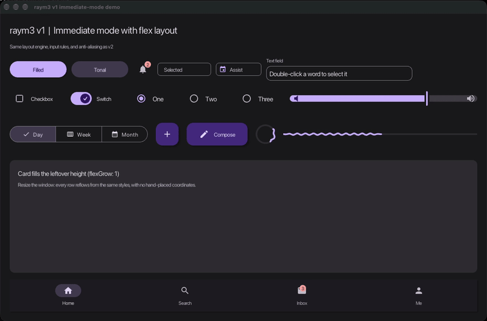

# raym3 v1: immediate mode



v1 is the immediate-mode API: you call `raym3::Button(...)`, `raym3::TextField(...)`
and the rest every frame, and the app owns all state. There is no retained tree.
The v2 work still pays off here, because both APIs share the build, the renderer,
the layout engine, and the cursor handling.

Run the demo above with `example_v1_demo` (`--autoplay` for the scripted walkthrough).
Source: `examples/v1_demo.cpp`.

## What v1 gained from the v2 work

| Area | Before | Now |
| --- | --- | --- |
| Layout | `raym3::Layout` was a no-op unless the app set `RAYM3_USE_YOGA`. Every `Alloc` returned an empty rect. | Yoga is on by default. `Layout::Frame` gives real flexbox rows, columns, gaps, centering, and `flexGrow`. |
| Edges | Raw shapes were jagged. | 4x MSAA by default (`RAYM3_ANTIALIASING`). |
| Checkbox, radio, switch | Drew glyphs from an icon font that raym3 does not ship, so standalone builds showed `?`. | Drawn as vectors with `Renderer::DrawCheckmark` and rounded shapes, which v2 shares. No font needed. |
| Checkbox label | Overlapped the box. | Starts after the 48dp touch slot, like the radio button. |
| TextField double-click | The second press also ran the drag code, which collapsed the word selection to the click point. | Double-click selects the word. Dragging extends it by whole words. Triple-click drag keeps everything selected. |
| TextField cursor | Requested the I-beam whenever the field had focus, so the cursor stayed an I-beam everywhere. | I-beam only under the pointer or during a drag-select. |
| Cursor flicker | `EndFrame` reset the OS cursor every frame. | `EndFrame` only changes the cursor when the request changes. |

## Laying out v1 components

Use `Layout::Frame`. It runs your callback twice: once to measure, then once to
draw with this frame's bounds. Only draw and handle input on the second pass.

```cpp
Layout::Frame(screen, [&](bool draw) {
  LayoutStyle root = Layout::Column();
  root.flexGrow = 1;
  root.padding = 24.0f;
  root.gap = 16.0f;
  Layout::BeginContainer(root);

  LayoutStyle row = Layout::Row();
  row.height = 64.0f;
  row.gap = 12.0f;
  row.align = 2; // align-items: center
  Layout::BeginContainer(row);
  Rectangle ok = Layout::Alloc(Layout::Fixed(140, 40));
  Rectangle field = Layout::Alloc(Layout::Fixed(360, 56));
  Layout::EndContainer();

  if (draw) {
    raym3::Button("OK", ok);
    raym3::TextField(text, sizeof(text), field, "Name");
  }

  Layout::EndContainer();
});
```

Rules that keep v1 layouts right:

- **Center with the parent.** Set `align = 2` on a row to center its children
  vertically, instead of nudging `y` by hand.
- **Fill with `flexGrow`.** `Layout::Flex(1)` takes the leftover space. Give it
  a `height` when it sits in a row and the control has a fixed height, such as
  a 40dp slider.
- **Pass the allocated rect straight through.** Offsetting it by hand, for
  example `slider.y + 4`, breaks centering the moment a row changes height.
- **Draw only when `draw` is true.** The measure pass must not draw or consume
  clicks.

## Input and cursor

- Components read raylib input directly, so there is no input loop to call.
  v2 needs one.
- Set cursors with `raym3::RequestCursor(...)` during the frame. `EndFrame` applies
  the last request. Don't call `SetMouseCursor` yourself every frame. It fights
  the request and flickers.
- `TextField` follows browser rules: mousedown focuses and places the caret.
  Double-click selects a word, triple-click selects all, and drag extends the selection.

## Building

The defaults are right for most apps. To opt out:

```cmake
set(RAYM3_USE_YOGA OFF CACHE BOOL "" FORCE)       # Layout calls become no-ops
set(RAYM3_ANTIALIASING OFF CACHE BOOL "" FORCE)   # no MSAA
```

See [v2 best practices](v2-best-practices.md) for the shared rendering rules:
triangle winding, morphing by outline, and clipping moving content.
